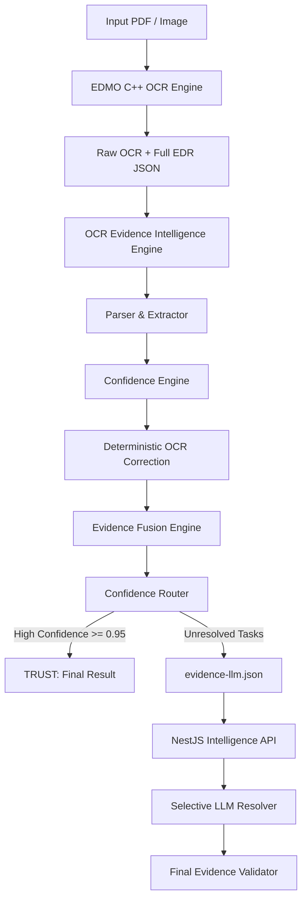

# OCR Evidence Intelligence Engine v0.1 - Architecture

## 1. System Role & Philosophy

The **OCR Evidence Intelligence Engine** acts as the high-speed, deterministic semantic bridge between the raw OCR generation layer and downstream intelligence services.

### Core Architecture Directives:
1. **The LLM is NOT the OCR engine.**
2. **The LLM is NOT the primary OCR correction mechanism.**
3. **The LLM is NOT called for clean, unambiguous documents.**
4. **The LLM is a selective semantic resolver invoked strictly when deterministic algorithms cannot resolve ambiguity.**

---

## 2. Pipeline Processing Stages

| Stage | Component | Latency Target | Description |
|---|---|---|---|
| **1. Ingestion** | `EdrParser` | < 20 ms | High-throughput deserialization of Full EDR JSON without data loss |
| **2. Field Extraction** | `TranscriptFieldExtractor` | < 20 ms | Domain classification into identity, academic, institution, and tabular records |
| **3. Correction** | `CorrectionEngine` | < 30 ms | Optical character confusion replacement, domain dictionary lookup, fuzzy matching |
| **4. Context** | `ContextualCorrectionEngine` | < 10 ms | Spatial and structural reinforcement using neighboring evidence |
| **5. Fusion** | `EvidenceFusionEngine` | < 20 ms | Multi-signal synthesis and multi-hypothesis OCR consensus |
| **6. Routing** | `ConfidenceRouter` | < 5 ms | Threshold-based decision gate (`TRUST` vs `LLM_REQUIRED`) |
| **7. LLM Context** | `TargetedLlmContextBuilder` | < 10 ms | Minimal context extraction with untrusted evidence security isolation |
| **8. Audit & Export** | `ZeroLossAuditor` & Serializer | < 10 ms | Zero-loss verification and serialization of 3 output artifacts |
| **Total Engine** | `EvidencePipeline` | **< 100 ms / page** | End-to-end processing |

---

## 3. Output Artifacts

Every pipeline execution generates exactly 3 files:
1. `output/evidence-full.json`: Full enriched representation retaining original OCR coordinates, token distributions, candidate corrections, and final fates.
2. `output/evidence-llm.json`: Minimal targeted context containing only unresolved tasks, neighboring context, and security guardrails.
3. `output/evidence-report.json`: Execution benchmarks, confidence distributions, correction rates, and zero-loss accounting.
